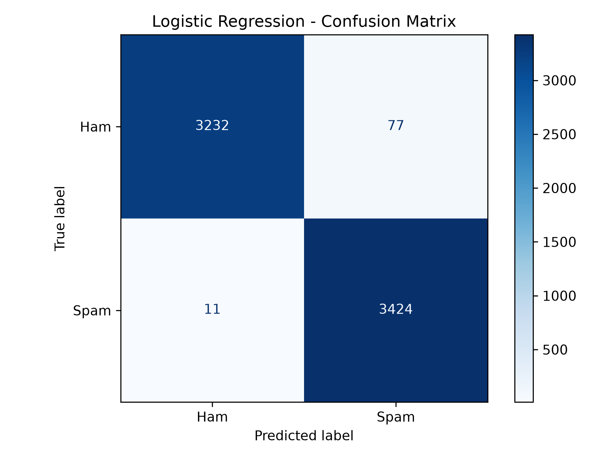
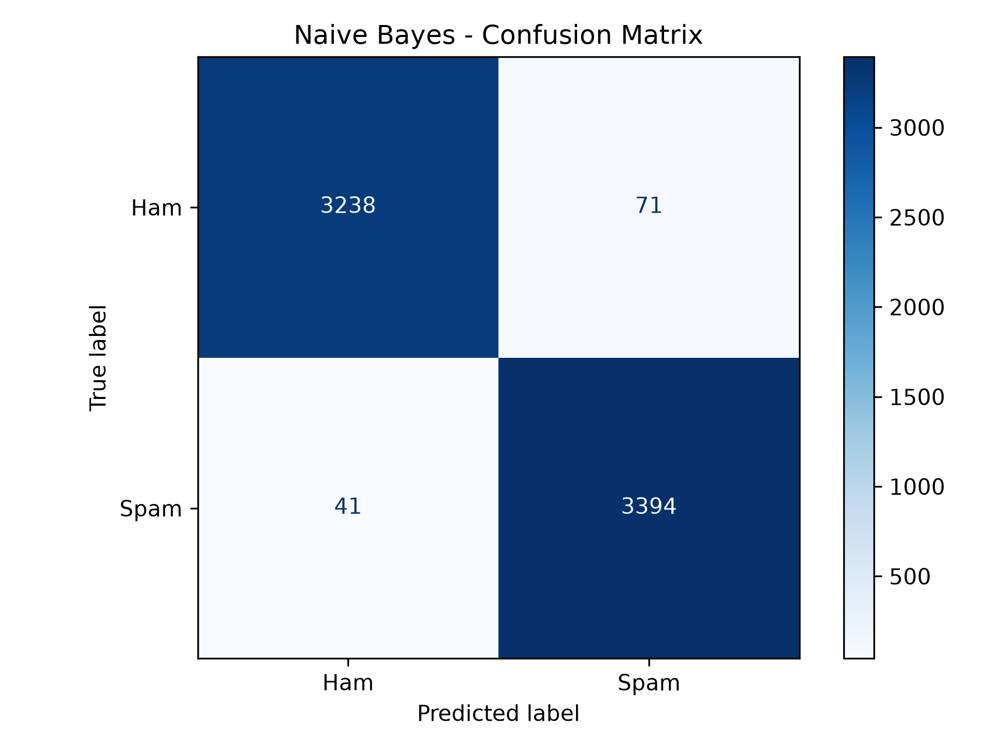

# 📧 Email Spam Detection using Machine Learning

A Machine Learning and Natural Language Processing (NLP) project that classifies email messages as **Spam** or **Ham (Not Spam)** using TF-IDF text vectorization and Logistic Regression.

The project includes text preprocessing, model evaluation, saved machine learning models, and an interactive Streamlit web application.

## 🚀 Project Demo

The Streamlit application allows users to enter an email message and receive a prediction with estimated Spam and Ham probabilities.

**Example Prediction:**
- **Predicted Class:** Spam
- **Spam Probability:** 90.80%
- **Ham Probability:** 9.20%

*Probabilities are model estimates and do not guarantee that an email is spam or legitimate.*

## 🎯 Project Objectives

- Classify emails as Spam or Ham.
- Apply NLP preprocessing to email text.
- Convert text into numerical features using TF-IDF.
- Train and compare machine learning classification models.
- Evaluate models using precision, recall, F1-score, and accuracy.
- Deploy the trained model through a Streamlit web application.

## 🛠️ Technologies Used

- Python
- Pandas
- Scikit-learn
- NLTK
- TF-IDF Vectorization
- Logistic Regression
- Multinomial Naive Bayes
- Matplotlib
- Streamlit
- Joblib
- Jupyter Notebook

## 📂 Project Structure

```text
email-spam-detection/
│
├── models/
│   ├── spam_logistic_regression.pkl
│   └── spam_tfidf_vectorizer.pkl
│
├── app.py
├── email_spam_detection.ipynb
├── requirements.txt
├── .gitignore
├── logistic_regression_confusion_matrix.png
└── naive_bayes_confusion_matrix.png
```

## 📊 Dataset

The project uses the **ENRON Spam dataset**, loaded from Hugging Face.

Dataset source: [bvk/ENRON-spam](https://huggingface.co/datasets/bvk/ENRON-spam)

| Dataset Detail | Value |
|---|---:|
| Total Emails | 33,716 |
| Spam Emails | 17,171 |
| Ham Emails | 16,545 |
| Training Samples | 26,972 |
| Testing Samples | 6,744 |

The data was divided into training and testing sets using an 80/20 split with stratification.

## ⚙️ Data Preprocessing

The email text preprocessing pipeline includes:

1. Converting text to lowercase.
2. Cleaning extra whitespace.
3. Tokenizing email text.
4. Removing English stopwords.
5. Converting text into numerical features using TF-IDF.

The TF-IDF vectorizer uses up to 10,000 features and includes unigrams and bigrams.

## 🤖 Machine Learning Models

Two classification algorithms were trained and evaluated:

- **Multinomial Naive Bayes**
- **Logistic Regression**

### Model Performance

| Metric | Naive Bayes | Logistic Regression |
|---|---:|---:|
| Accuracy | 98.34% | 98.70% |
| Spam Precision | 97.95% | 97.80% |
| Spam Recall | 98.81% | 99.68% |
| Spam F1-Score | 98.38% | 98.73% |

**Best Overall Model:** Logistic Regression

Logistic Regression achieved the higher accuracy, spam recall, and spam F1-score on the test set. It also missed fewer spam emails in the evaluation.

## 📈 Model Evaluation

Confusion matrices were generated to evaluate the classification results.

### Logistic Regression



### Naive Bayes



## 💻 Installation and Setup

### 1. Clone the Repository

```bash
git clone https://github.com/alimuhammad-007/email-spam-detection.git
```

### 2. Open the Project Folder

```bash
cd email-spam-detection
```

### 3. Create a Virtual Environment

```bash
python -m venv .venv
```

Activate it on Windows PowerShell:

```powershell
.\.venv\Scripts\Activate.ps1
```

### 4. Install Dependencies

```bash
python -m pip install -r requirements.txt
```

### 5. Run the Streamlit Application

```bash
python -m streamlit run app.py
```

The application should open in your browser. Enter an email message and click **Check Email** to view the prediction.

## 🧪 Example Test Emails

**Spam Example**

```text
Congratulations! You have won a free cash prize.
Click here now to claim your reward.
```

Expected result: Spam.

**Ham Example**

```text
Hi John,

I have attached the meeting agenda for tomorrow.
Please review the document and let me know if you have any questions.

Best regards
```

Expected result: Ham (Not Spam).

*Predictions can vary depending on the text provided.*

## 🔮 Future Improvements

- Improve detection of phishing emails.
- Test the model on additional email datasets.
- Add more evaluation visualizations.
- Improve the user interface and user experience.
- Explore additional NLP and classification techniques.

## 👨‍💻 Author

**Ali Muhammad**

- GitHub: [@alimuhammad-007](https://github.com/alimuhammad-007)
- LinkedIn: [Ali Muhammad](https://www.linkedin.com/in/ali-muhammad-41b921372/)

## 📄 License

This project is intended for educational and portfolio purposes. A formal open-source license has not yet been added.